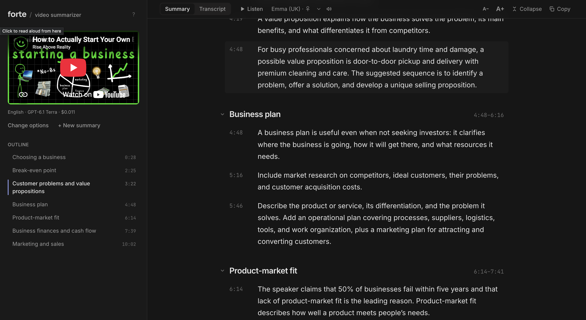
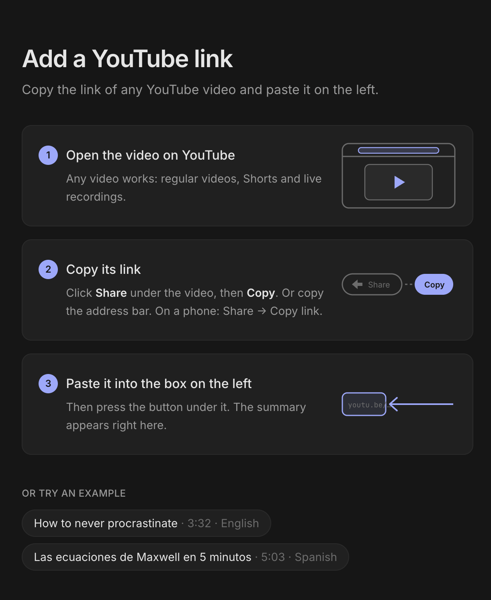

# Forte video summarizer

> **Long YouTube video? Get the short version.** Read it, hear it, and jump to any part.

<p align="center">
  
</p>

## ✨ What it does

- 📝 **Turns a long video into short notes**
- ⏱️ **Click a time** to jump to that moment in the video
- 🔊 **Reads the notes out loud**, in a natural voice
- 🌍 **Writes in 12 languages** (AI mode)

## 🆓 Two ways to use it

| | 🆓 **Free** | ✨ **AI** |
|---|---|---|
| **Costs** | Nothing | About 1¢ a video, on your own key |
| **Needs a key** | No | An OpenAI or Claude key |
| **You get** | The best bits, word for word | A neat written summary |
| **Language** | The video's own | Any of 12 |

You can switch between them any time.

## 🚀 Start it

**You need:** [uv](https://docs.astral.sh/uv/) and Node.js 20+ (on a Mac: `brew install uv node`).

**Then run one command:**

```bash
git clone https://github.com/svashisht-cloud/ForteVideoSummarizer.git && cd ForteVideoSummarizer && ./start.sh
```

It installs everything and opens **http://localhost:5173**.

- **Stop:** press `Ctrl-C`.
- **Next time:** just run `./start.sh`.

## 👆 How to use it

<p align="center">
  
</p>

1. **Copy** a YouTube link.
2. **Paste** it into the box on the left.
3. **Press** the button. Your notes appear on the right.

> 💡 The first time you press **Listen**, the voice (~350 MB) downloads once.

## 🆘 Need help?

| If you see… | Try this |
|---|---|
| "YouTube is blocking requests" | Use your home internet, not a VPN or a cloud server. |
| "Can't reach the server" | Is `./start.sh` running? Open `localhost:5173`, not `127.0.0.1`. |
| "API key was rejected" | Check the key in the app or in `backend/.env`, then restart. |
| A robotic voice | Normal for German, Korean, Arabic, Russian and Japanese: they use your device's voice. |

---

<details>
<summary><b>⚙️ Settings</b> (optional)</summary>

<br>

Settings live in `backend/.env`. It's made for you on the first run, and it's never committed.

| Setting | What it does |
|---|---|
| `OPENAI_API_KEY` / `ANTHROPIC_API_KEY` | A key for everyone using this computer. Optional: you can type your own in the app. |
| `OPENAI_MODEL` / `ANTHROPIC_MODEL` | The default AI model (`gpt-6.1-terra` / `claude-opus-5-5`). |
| `STT_ENGINE` | How videos without captions get listened to: `local` (Apple Silicon) or `openai`. |
| `OPENAI_STT_MODEL` | The OpenAI model for that (`whisper-1`). |
| `REQUIRE_USER_KEY` | `true` makes everyone bring their own key (for a shared server). |

**About your key:** it's saved in your browser only. It's sent with each request and never stored, logged or cached on the server.

</details>

<details>
<summary><b>🛠️ For developers</b></summary>

<br>

**Run the two parts by hand** (two terminals):

```bash
cd backend && cp .env.example .env && uv sync && uv run --env-file .env uvicorn app.api.main:app --reload
cd frontend && npm install && npm run dev
```

API docs: http://localhost:8000/docs. Set `NO_OPEN=1 ./start.sh` to skip opening the browser.

**Tests:**

```bash
cd backend && uv run pytest
cd frontend && npm test && npm run build && npm run lint
```

**How it works:**
- **Free:** captions → ~30 s blocks → TextRank picks the key blocks in each chapter.
- **AI:** captions (or speech-to-text) → ~12 min chunks summarized in parallel → merged into a TL;DR plus sections.

**Layout:**

```
backend/app/pipeline/   captions, speech-to-text, summarizing, read-aloud, cache
backend/app/api/        FastAPI: /jobs, /models, /tts, /keys/check
frontend/src/           React + TypeScript + Tailwind
```

The design decisions are in [`CLAUDE.md`](CLAUDE.md).

</details>
